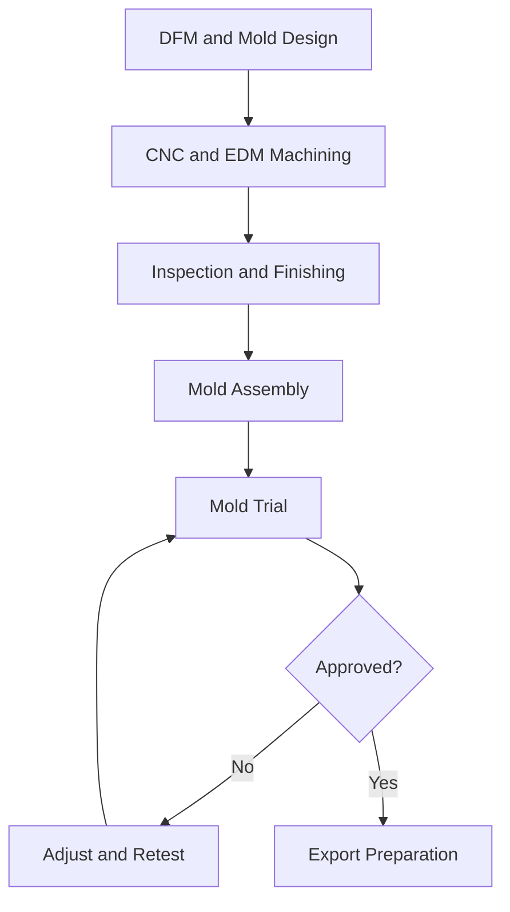

# Export Injection Mold Manufacturing: Workflow and Quality Checklist

Export injection molds require more than accurate machining. They must fit the customer's production equipment, produce consistent plastic parts, and remain reliable after shipment. A clear manufacturing workflow and proper quality checks can help prevent costly problems once the mold arrives overseas.

## Manufacturing Workflow

The process typically follows six main stages, with adjustments and additional trials when necessary.

## Key Manufacturing Stages

### 1. DFM and Mold Design

Engineers review wall thickness, draft angles, undercuts, and parting lines before designing the mold. The design defines the cavity, core, cooling channels, runners, gates, and ejection system. Machine compatibility and customer tooling standards should be confirmed early.

### 2. CNC and EDM Machining

CNC milling produces mold plates, cavities, cores, and other components. EDM handles deep ribs and narrow features that are difficult to machine with conventional cutting tools, while Wire EDM is used for precise profiles and through-features. The selected processes depend on geometry, material, and tolerances.

### 3. Inspection and Finishing

Critical dimensions are checked using CMM equipment, gauges, or other measuring tools. Mold surfaces may require polishing or texturing depending on the plastic part's appearance and functional requirements.

### 4. Mold Fitting and Assembly

The cavity, core, and parting surfaces are fitted and aligned. Sliders, lifters, ejector pins, and other moving parts are checked for smooth operation. Cooling connections and hot runner components are also inspected where applicable.

### 5. Mold Trial and Validation

Initial trials evaluate material filling, cooling, ejection, and part quality. Samples are inspected for dimensional accuracy and defects such as flash, sink marks, and warpage. Problems may require adjustments to the mold or processing parameters before approval.

### 6. Acceptance and Export Preparation

After validation, the mold is cleaned, protected against corrosion, and secured for transport. Export documentation may include mold drawings, trial records, maintenance instructions, and spare parts lists, depending on the customer's requirements.

## Pre-Shipment Quality Checklist

Before shipping an injection mold overseas, the following items should be verified against the agreed specifications:

- [ ] Critical cavity, core, and insert dimensions meet approved drawings.
- [ ] Sliders, lifters, and ejection systems operate correctly.
- [ ] Cooling channels and connections pass the required leak tests.
- [ ] Trial samples meet dimensional and appearance requirements.
- [ ] Mold mounting and machine interfaces match the customer's equipment.
- [ ] Required drawings, inspection records, and spare parts are prepared.
- [ ] Moving components are secured and exposed surfaces protected for transportation.

## Common Engineering Risks

| Risk | Potential Impact | Recommended Check |
|---|---|---|
| Cooling imbalance | Warpage and dimensional variation | Review cooling design and trial results |
| Poor component fitting | Flash, wear, or mechanical interference | Verify alignment and movement |
| Machine incompatibility | Installation delays | Confirm mounting and connection specifications |
| Insufficient trial validation | Problems during production | Review samples and agreed acceptance criteria |
| Missing spare parts | Longer maintenance downtime | Confirm critical spares and documentation |

## Engineering Note

A mold that produces acceptable samples during an initial trial is not necessarily ready for overseas production. Long-term reliability also depends on mechanical movement, cooling performance, machine compatibility, and maintainability.

For export molds, these factors deserve particular attention because troubleshooting and repairs may be more difficult once the tool is operating at another factory.

**The goal is not simply to manufacture an accurate mold, but to deliver one that can operate reliably in the customer's production environment.**

---

## Reference

Original detailed manufacturing process:

https://rjcmold.com/guides/export-injection-mold-manufacturing-process/
